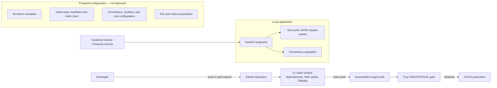

# CloudOps Platform

CloudOps Platform is a small FastAPI service used to demonstrate the engineering work around a secure local application delivery path: container hardening, repeatable Python dependencies, automated tests, secret and vulnerability scanning, and deployment configuration prepared for later review.

> **Project status:** This is a portfolio project, not a production service. No AWS infrastructure, Kubernetes cluster, Helm release, or monitoring stack has been deployed. No container image has been published. GHCR publishing remains disabled; SEC-002 remains OPEN; K3s/Calico remains NO-GO.

## Architecture



The application provides six endpoints:

| Endpoint | Purpose |
|---|---|
| `/` | Service metadata |
| `/health` | Liveness response |
| `/ready` | Readiness response; currently checks application/process readiness only |
| `/api/v1/status` | Service status |
| `/api/v1/info` | Runtime information and process uptime |
| `/metrics` | Prometheus text exposition with request counters and latency histograms |

Request middleware emits structured JSON events with internal request IDs and bounded route/method labels. Metrics and logging are best-effort so instrumentation failures do not replace application responses. See [architecture and implementation status](docs/architecture.md) and [observability details](docs/observability.md).

## Main technologies

| Area | Technologies |
|---|---|
| Application | Python, FastAPI, Uvicorn, Pydantic Settings |
| Testing and quality | pytest, Ruff |
| Dependencies | pip requirements inputs and platform-specific SHA-256-verified locks |
| Containers and delivery | Docker, Docker Compose, GitHub Actions |
| Security checks | Gitleaks, Trivy |
| Deployment configuration | Terraform, Kubernetes, Helm; prepared for future use, not deployed |
| Observability | Prometheus client metrics, Grafana dashboard/configuration, Loki values; services are not running |

## Capabilities and verification

| Capability | Evidence and current boundary |
|---|---|
| FastAPI, settings, health/readiness, request logging, and metrics | Implemented and covered by the local pytest suite. A prior secure local demo verified all six routes and request counters; see [local verification evidence](docs/local-verification-report.md). |
| Production container and Compose | Digest-pinned Alpine image installs a platform-specific lock with `--require-hashes` and `--only-binary=:all:`. Compose uses a non-root image, loopback-only port binding, dropped capabilities, read-only root, `/tmp` tmpfs, and no-new-privileges. DEV-015 verified a local container; this README task does not start one. |
| Python dependencies | Runtime and development locks pin direct and transitive versions with SHA-256 hashes. Hash checks protect artifact consistency against reviewed values; they do not authenticate package publishers. |
| GitHub Actions | [Run 39468033513](https://github.com/avinashmnth2507-dev/cloudops-platform/actions/runs/39468033513) passed for commit `8e711c8a5338b68fde1bff1ba928088d424c41e9`. Its test job (Ruff, 178 pytest tests, Gitleaks) and image job (build and Trivy gate) succeeded. Image handoff and publication were skipped. This run validates that commit, not the documentation edits in this working tree. |
| Kubernetes and Helm | Manifests and chart have offline tests and render checks. No API server, cluster, Helm release, or workload runtime has been validated. The application image must be supplied as an approved immutable digest before rendering/deployment. |
| Prometheus, Grafana, and Loki | Application metrics and structured request events are implemented. The repository contains monitoring/logging configuration, but no Prometheus scrape, dashboard, or log-collection service is running. |
| Terraform, K3s, and Calico | Configuration and guarded/offline checks exist. No cloud resources or cluster were created; K3s/Calico installation remains NO-GO. |

For a concise component-by-component status, see the [portfolio completion checklist](docs/portfolio-completion-checklist.md). The [portfolio evidence index](docs/portfolio-evidence.md) distinguishes current CI evidence from historical screenshots and local runtime evidence.

## Local development and testing

Use an existing Python environment and the project's top-level development requirements:

```bash
python3 -m venv .venv
source .venv/bin/activate
pip install -r requirements.txt
pytest -q
ruff check .
```

`requirements.txt` retains the direct development pins for this local setup. GitHub Actions uses `requirements-dev-ubuntu-py313.lock` with hash verification on Ubuntu; do not treat that Linux lock as a macOS/Python 3.14 lock. The production image uses `requirements-runtime-alpine-py313-amd64.lock`. See [Python dependency locking](docs/python-dependency-locking.md).

To run the service locally after installing dependencies:

```bash
uvicorn app.main:app --reload
```

The bounded local API checker is `scripts/demo-local.sh`; it only checks an already-running service on a numeric loopback address and never starts or stops it. For offline repository checks, run:

```bash
scripts/verify-local.sh
```

The verification script uses tools already installed on the machine. It does not install tools, contact a cluster or registry, or deploy infrastructure. See the [local demo runbook](docs/local-demo.md) for details.

## Docker execution

The production Dockerfile uses a digest-pinned Python Alpine base and a hash-verified, binary-only runtime lock. Compose applies additional runtime restrictions and publishes port 8000 only on loopback. To build and run locally when you intentionally choose to do so:

```bash
docker compose up --build
```

Then use `scripts/demo-local.sh` from another terminal. Stop the Compose service with `Ctrl+C` or `docker compose down` when you are finished. These commands create or change local Docker resources; they are not part of the offline validation performed for the current documentation changes.

## CI and release controls

The workflow runs on pull requests and pushes to `main`. The test job installs the Ubuntu/Python 3.13.16 development lock with pip hash enforcement, then runs Ruff, pytest, and Gitleaks. A successful push to `main` also builds a Linux amd64 image and runs the configured Trivy HIGH/CRITICAL failure gate. The image export/checksum/upload steps and `publish` job remain disabled. There is no `workflow_dispatch` release path, and GHCR contains no image established by this project workflow.

The [manual publication design](docs/ghcr-publication-design.md) is documentation only. A future release would need separate approval, repository/environment protection, exact-source verification, provenance/SBOM/signature decisions, and digest verification.

## Kubernetes and Helm readiness

Kubernetes manifests and the Helm chart express deployment configuration; they do not prove a deployment. The standalone Deployment has an empty image field, and Helm fails closed unless given a valid digest-pinned image reference. Ingress, ServiceMonitor, and Helm NetworkPolicy are disabled by default; HPA is configured but requires a functioning Metrics API. Kubernetes security, selectors, probes, resources, image validation, and policy guards have offline test coverage only.

The standalone NetworkPolicy denies ingress to CloudOps pods. Actual ingress-controller and monitoring identities and CNI policy enforcement are not verified, so SEC-002 remains OPEN. Flannel is disabled in the proposed K3s settings and a verified Calico CNI is a prerequisite; K3s/Calico bootstrap remains NO-GO. Review the [Kubernetes guide](docs/kubernetes.md), [Helm guide](docs/helm.md), [Calico installation status](docs/calico-installation.md), and [deployment prerequisites](docs/deployment.md) before any separately authorized deployment.

## Security and limitations

- Gitleaks scans source changes in CI; Trivy blocks images with configured HIGH or CRITICAL vulnerability findings.
- The production image uses a pinned base digest, hash-verified runtime dependencies, a non-root user, and an HTTP healthcheck. Compose adds a read-only root filesystem, a temporary filesystem for `/tmp`, dropped Linux capabilities, no-new-privileges, and loopback-only port publishing.
- Dependency hashes verify downloaded artifacts against approved hash values. They do not prove package publisher identity or source trustworthiness.
- Terraform examples can create billable AWS resources. They have not been applied; no AWS resources are reported as deployed.
- Kubernetes API acceptance, scheduling, runtime health, NetworkPolicy enforcement, autoscaling, monitoring discovery, persistent storage, and production capacity remain unverified.
- This service does not implement cloud resource management and has no production user, uptime, performance, or certification claims.

See [security controls and limits](docs/security.md), [known lessons](docs/lessons-learned.md), and [cost-control notes](docs/cost-control.md).

## Repository map

```text
app/                  FastAPI service and request instrumentation
tests/                API, security, Docker/Compose, CI, Helm, and manifest tests
requirements-*.lock   Platform-specific hash-verified dependency locks
.github/workflows/    GitHub Actions test, build, and scan workflow
terraform/            AWS infrastructure examples; not applied
k8s/                  Kubernetes and Calico configuration; not deployed
helm/cloudops/        CloudOps Helm chart; not installed
monitoring/           Prometheus/Grafana configuration; not running
logging/              Loki configuration and notes; not running
scripts/              Offline verification and guarded demonstration/bootstrap tools
docs/                 Architecture, security, operations, and portfolio evidence
```

## Portfolio evidence

The [portfolio project summary](docs/portfolio-project-summary.md) provides recruiter-facing highlights. Existing screenshots are local portfolio assets and may be historical or contain local identifiers; see [screenshot guidance](docs/screenshots.md) before sharing them. Do not present a configuration file, screenshot, or CI pass as proof of a cloud or Kubernetes deployment.

## License

The repository includes an MIT `LICENSE` file. Confirm you have the rights to publish all project content and any future screenshots or third-party assets.
