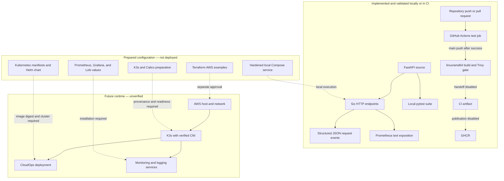

# Architecture and Implementation Status

CloudOps Platform is a portfolio project built around a small FastAPI service and its local delivery and operations path. It demonstrates application behavior and engineering controls without representing prepared cloud or cluster configuration as a deployed system. **No AWS infrastructure, Kubernetes cluster, or monitoring stack has been deployed. GHCR publishing is disabled.**

## Implemented application and delivery path

- FastAPI exposes `/`, `/health`, `/ready`, `/api/v1/status`, `/api/v1/info`, and `/metrics`. Readiness currently reports application/process readiness; it does not probe external dependencies.
- Middleware emits structured JSON request events and records Prometheus counters and latency histograms. Route and method labels are bounded, and instrumentation failures do not replace application responses.
- The Dockerfile uses a digest-pinned Python 3.13.16 Alpine 3.24 base and a platform-specific runtime lock installed with `--require-hashes` and `--only-binary=:all:`. The image runs as UID/GID `10001:10001` and defines an HTTP healthcheck.
- Docker Compose publishes `127.0.0.1:8000`, drops all Linux capabilities, uses a read-only root filesystem and `/tmp` tmpfs, and enables `no-new-privileges`.
- GitHub Actions uses the hash-verified Ubuntu/Python 3.13.16 development lock, Ruff, pytest, and Gitleaks. Main pushes build a Linux amd64 image and run a Trivy HIGH/CRITICAL gate.

The local pytest suite covers the API and offline configuration checks. A prior [DEV-015 local demonstration](local-verification-report.md) built and started the secured local application, checked all six endpoints, and parsed request counters from `/metrics`. This demonstrates one local run only; it does not establish a current running container or monitoring service.

## Current CI evidence

GitHub Actions [run 39468033513](https://github.com/avinashmnth2507-dev/cloudops-platform/actions/runs/39468033513) passed for commit `8e711c8a5338b68fde1bff1ba928088d424c41e9`. The test job passed dependency installation, Ruff, 178 pytest tests, and Gitleaks. The image job passed the image build and configured Trivy gate. Image export, checksum, artifact upload, and the GHCR publish job were skipped. The image was not published. The run predates the current portfolio documentation edits, so it is evidence for that commit, not these uncommitted docs.

## Architecture map

The diagram distinguishes the existing local/CI path from prepared and future runtime configuration.

## Prepared configuration and blockers

- **Kubernetes and Helm:** Deployment, Service, probes, resources, security contexts, HPA, Ingress, ServiceMonitor, and NetworkPolicy templates have offline validation. The standalone Deployment image is empty by design; Helm requires an explicit digest-pinned image. No API-server acceptance, scheduling, or release has been tested.
- **NetworkPolicy:** The standalone policy denies ingress to CloudOps pods. Helm NetworkPolicy defaults to disabled and requires explicit selectors. Ingress-controller and metrics identities and CNI enforcement remain unverified; keep **SEC-002 OPEN**.
- **K3s and Calico:** Bootstrap/configuration work is offline only. K3s refuses installation and Calico installation remains **NO-GO** until provenance, separately approved artifacts, host prerequisites, CNI readiness, and recovery are established.
- **Autoscaling and resources:** CPU/memory requests and limits are declared and statically checked. HPA is configured but depends on a working Metrics API; scheduling and scaling have not been tested.
- **Observability:** Application metrics and request events are implemented. Prometheus/Grafana/Loki configuration is present, but no scrape, dashboard, persistence, or log-collection pipeline is running.
- **Terraform:** VPC, subnet, IAM, security group, and EC2 examples are present. They have not been initialized or applied and may create billable resources.
- **Publication:** GHCR handoff and publication are disabled. No image has been published. A future deployment requires an independently reviewed, available immutable digest.

## Related documentation

- [Project overview and local development](../README.md)
- [Security controls and limits](security.md)
- [Deployment prerequisites](deployment.md)
- [Kubernetes configuration](kubernetes.md)
- [Helm offline validation](helm.md)
- [Portfolio evidence index](portfolio-evidence.md)
