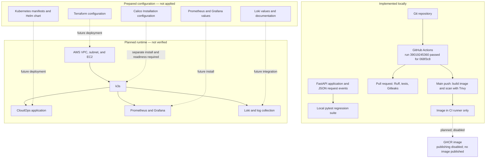

# Architecture and Implementation Status

CloudOps Platform is a portfolio project centered on a small FastAPI service. This page separates components implemented locally from configuration prepared for a future deployment. **No AWS infrastructure or Kubernetes cluster has been deployed from this repository.**

## Implemented locally

- FastAPI endpoints for application metadata, health, readiness, status, runtime information, and Prometheus metrics; structured JSON request events are written to stdout.
- The local pytest suite covers all six application endpoints, metrics, request logging, instrumentation-failure handling, and offline configuration checks.
- Dockerfile and Docker Compose configuration.
- GitHub Actions run [39019245360](https://github.com/avinashmnth2507-dev/cloudops-platform/actions/runs/39019245360) passed on commit `068f3c8c67e754a19a092c79764a7b24fa40c0c1`: test and image jobs succeeded, while publishing was skipped. The image was built and scanned in the runner; it was not published.

The local verification report records the stopped Compose container and the reason it was not started for a live demo. Run #5 remains historical evidence for an older commit. Local tests and static checks do not deploy cloud or cluster infrastructure. The local Python environment is 3.14; the workflow uses Python 3.13.

## Prepared configuration — not deployed

- Terraform describes a VPC, public subnet, security group, IAM role, and EC2 instance.
- k3s bootstrap settings and a Calico `Installation` custom resource are present.
- Kubernetes manifests and the CloudOps Helm chart describe the application, service, ingress, autoscaling, monitoring, and policy settings.
- Prometheus/Grafana values and a dashboard JSON are present. They do not establish an installed monitoring stack or automatic dashboard provisioning.
- Loki values and documentation are present; a complete log collection pipeline is not demonstrated.

## Planned deployment architecture

The diagram shows the intended flow, not a deployed system. Dashed edges indicate proposed or disabled steps.

On main pushes, the workflow builds and scans an image after tests succeed. In run `39019245360`, the build and Trivy scan passed, while image export and the `publish` job were skipped by the disabled gate. The older Run #5 passed for commit `f6ba78bcdda1a843e9cb33742826b46e98976f00`. Kubernetes and Helm image references still contain placeholders and are not deployable as written. See the [local verification report](local-verification-report.md) for the separately checked app/container state.

## Deployment prerequisites and limits

- **AWS:** No infrastructure has been deployed. The Terraform configuration includes public HTTP ingress and may incur EC2, EBS, public IPv4, data-transfer, and CPU-credit charges.
- **k3s and Calico:** The bootstrap disables Flannel and k3s's embedded NetworkPolicy controller. A separately installed and healthy Calico CNI is required before relying on pod networking. Runtime compatibility and enforcement are unverified. See [Calico preparation](calico-installation.md) and [deployment prerequisites](deployment.md).
- **NetworkPolicy:** SEC-002 remains open. The standalone policy denies application ingress, while Helm NetworkPolicy is disabled by default. Do not enable or apply a policy until source workload identities and CNI enforcement have been verified. See [Kubernetes security notes](kubernetes.md).
- **Ingress:** The configured application Ingress is HTTP-only; TLS is deferred. Terraform permits public TCP 80. Review exposure before any future deployment.
- **Autoscaling:** HPA configuration exists, but a working Metrics API and runtime scaling have not been verified.
- **Monitoring:** Prometheus/Grafana are configured but not installed. Scraping, persistent storage, dashboard provisioning, and node capacity remain unverified. See [monitoring status](monitoring.md) and the [resource budget](monitoring-resource-budget.md).

## Related documentation

- [Project overview and local development](../README.md)
- [Security controls](security.md)
- [Development capacity profiles](development-profiles.md)
